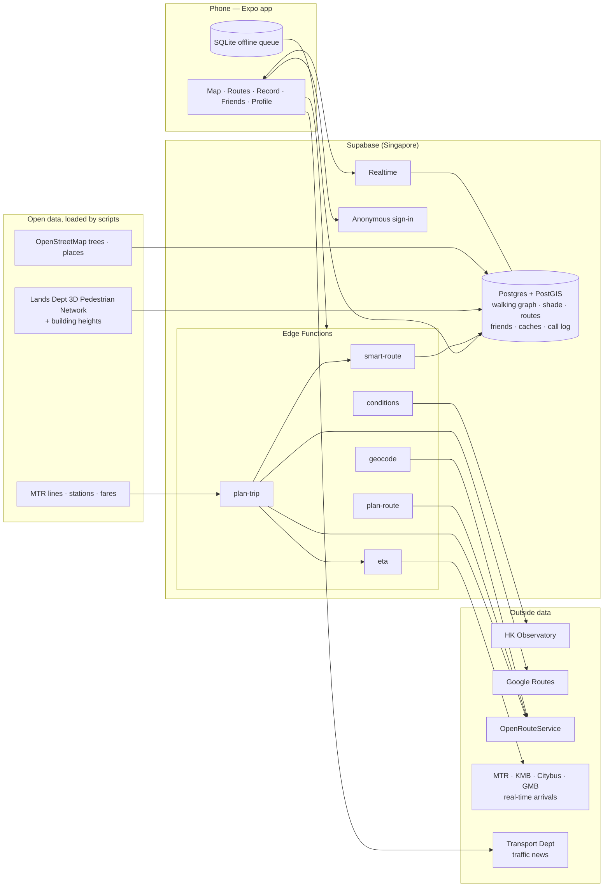

# Scenic Stroll — presentation brief

Facts for the pitch deck, checked against the code, the live Supabase project and the eval files on
**2026-10-18**. Numbers come from `eval/results/`, the test runs and the live database; anything we
haven't measured says "not measured". No keys or `.env` values are in this file.

---

## 1. The app

**Name:** Scenic Stroll

**One line:** Walking directions for Hong Kong that choose the shaded, sheltered or step-free way,
not just the shortest one — and compare walking honestly with the MTR, buses, car and taxi.

**The problem:** Map apps send pedestrians along the geometrically shortest line: into full sun at
33 °C, through uncovered streets in a rainstorm, up stairs when you have a pram or wheelchair. Locals
know better ways (through malls, footbridges, covered walkways), but that knowledge isn't in any map.
Around CityU / Kowloon Tong / Festival Walk the difference is often a minute or two of extra walking
for far less sun or rain. People also drive or take taxis for short trips that are just as quick on foot.

**Area:** CityU, Kowloon Tong MTR and Festival Walk (the walking map covers this area plus a 300 m
margin). Public transport, car and taxi comparisons work for trips anywhere in Hong Kong.

---

## 2. Features, by tab

Status: **Working** = works in the app today · **Partly working** = works with a stated gap ·
**Not built** = planned, no working feature.

### Map (route planning)

| Feature                                                                                                    | Status         | Notes                                                                                                          |
| ---------------------------------------------------------------------------------------------------------- | -------------- | -------------------------------------------------------------------------------------------------------------- |
| Map of the demo area, your location, long-press to drop a point                                            | Working        |                                                                                                                |
| Search: landmarks (EN/中), My location, free-text place search                                             | Working        | 11 MTR exits, Festival Walk, 7 CityU buildings as presets; free text via OpenRouteService                      |
| "Now" card: live HKO weather + warnings, sun position → mode (rain / heat / night / severe / normal)       | Working        | Falls back to cached data, then time of day, and says so                                                       |
| Computed walking routes on our own walking map: Best now · Fastest · Shaded · Sheltered · Cool · Step-free | Working        | Up to 4 options, explanation on each card                                                                      |
| Shade estimate per path (buildings + trees, every 30 min 07:00–19:00), exposure bar, coloured route        | Working        | An estimate, labelled as one                                                                                   |
| Step-free routes never use stairs/escalators; unknown parts say "unconfirmed"                              | Working        | Checked by the eval (66/66 checks)                                                                             |
| Opening hours of indoor links (e.g. Festival Walk) at the time you'd reach them; "closing soon" warnings   | Working        |                                                                                                                |
| Departure time picker (now / +15 / +30 / +1 h / at…)                                                       | Working        |                                                                                                                |
| Standard route from a routing provider as a baseline                                                       | Partly working | Provider (OpenRouteService) routing has been down since 18 Oct; computed routes inside the area are unaffected |
| Follow mode ("Start walking"): instructions, time left, re-plans after 20 s > 40 m off route               | Working        | Demo: Simulate walk                                                                                            |
| Weather change while walking → "It's started raining — a sheltered route adds 2 min. Switch?"              | Working        | Demo: Make it rain                                                                                             |
| Report a blocked path → everyone is routed around it for 3 h                                               | Working        |                                                                                                                |
| Feedback after a walk ("Was it sheltered as promised?") adjusts future routing                             | Working        | 3+ people disagreeing overrule the map; demo walks never count                                                 |
| "Save as a community route" after a computed walk                                                          | Working        |                                                                                                                |
| Layers: Shade now, Transit stops, Traffic, Incidents                                                       | Working        |                                                                                                                |
| Floor selector inside Festival Walk / CityU buildings                                                      | Partly working | Floors come from recorded checkpoints; none recorded yet, so it says so                                        |
| Place card (route here/from, save, share, nearest exits)                                                   | Working        |                                                                                                                |
| Community routes near you (bottom sheet)                                                                   | Partly working | The list works; the database has 0 community routes today                                                      |

### Map — comparing ways to travel (All · Walk · Transit · Car · Taxi tabs)

| Feature                                                                                           | Status    | Notes                                                                                                                         |
| ------------------------------------------------------------------------------------------------- | --------- | ----------------------------------------------------------------------------------------------------------------------------- |
| Side-by-side cards: time, arrival, cost, CO₂, walking minutes, leg strip, labels                  | Working   |                                                                                                                               |
| Car with **live traffic** (Google Routes), route coloured by traffic                              | Working   | Since 18 Oct (Google key set); before that typical times, labelled                                                            |
| Public transport (MTR, and buses/minibuses via Google when available), line colours, Octopus fare | Working   | Our own MTR planner (100 stations, 12 line branches) is the fallback; its ride times are estimated from distance and labelled |
| Live next train at the first boarding station (MTR Next Train)                                    | Working   | First boarding leg only                                                                                                       |
| Taxi with official urban meter fare range (tariff from 14 Jul 2024) + 3 min pickup                | Working   | Tolls and luggage not included (noted on card)                                                                                |
| Sort: Best · Fastest · Cheapest · Greenest · Least walking                                        | Working   |                                                                                                                               |
| Green nudge ("As quick as driving · saves ~390 g CO₂")                                            | Working   |                                                                                                                               |
| "Leave in 4 min for the 08:30 KTL" on the selected transit card, buzz when it's time              | Working   | Refreshes every 30 s                                                                                                          |
| "Traffic changed: another route now saves N min · Switch"                                         | Working   | Car/taxi re-planned every 2 min; needs live traffic (now on)                                                                  |
| Simulate rush hour (demo switch, car × 2.5)                                                       | Working   | Labelled "simulated"                                                                                                          |
| Saved answers for the demo trips when the network fails                                           | Working   | Labelled "saved for the demo"                                                                                                 |
| Full multimodal follow mode (step-by-step through a bus/MTR trip)                                 | Not built |                                                                                                                               |

### Routes

| Feature                                                                                      | Status    | Notes           |
| -------------------------------------------------------------------------------------------- | --------- | --------------- |
| My routes: drafts, waiting to upload (with reason), uploaded; edit + delete (also on server) | Working   |                 |
| Saved / Explore tabs                                                                         | Not built | The tabs say so |
| Search and match community routes to your trip (`find-routes`)                               | Not built | Phase 4         |

### Record

| Feature                                                                                                                                | Status        | Notes                                                             |
| -------------------------------------------------------------------------------------------------------------------------------------- | ------------- | ----------------------------------------------------------------- |
| GPS recording with live trace, gap detection, cleaning (accuracy/speed filters, simplification)                                        | Working       | 19 unit tests                                                     |
| Checkpoints (7 kinds, e.g. lift, stairs, entrance) with floors                                                                         | Working       |                                                                   |
| Review before sharing: title, start/end snapped to landmarks, description in any language (EN / 粵語), privacy trim 50 m, show-my-name | Working       | Raw GPS never leaves the phone                                    |
| Offline-first: survives the app being killed mid-walk; upload queue retries                                                            | Working       |                                                                   |
| Data-collection mode (big buttons, "Save & record another")                                                                            | Working       |                                                                   |
| **AI turns descriptions into tags**                                                                                                    | **Not built** | Tag list and data formats exist; no AI function deployed (see §4) |
| Route verification by other walkers, Verified badge                                                                                    | Not built     | Badge UI exists but nothing can earn it yet (Phase 5)             |
| On-route pop-ups (places, events)                                                                                                      | Not built     | Phase 6                                                           |

### Friends

| Feature                                                                                     | Status    | Notes                                   |
| ------------------------------------------------------------------------------------------- | --------- | --------------------------------------- |
| Friend codes + QR, requests, accept/decline/remove/block                                    | Working   |                                         |
| Friend profiles, activity (public routes only), weekly leaderboard                          | Working   |                                         |
| Live location sharing (who, how long, precision), friend markers on the map                 | Working   |                                         |
| "Getting there: best is MTR, 12 min" + time per mode on a friend's profile, Route to friend | Working   | Needs the friend to be sharing location |
| Meetups / meeting point                                                                     | Not built |                                         |

### Profile

| Feature                                                                    | Status         | Notes                                                                                |
| -------------------------------------------------------------------------- | -------------- | ------------------------------------------------------------------------------------ |
| Name, level, points, stats, badges                                         | Partly working | Calculated from your recordings; verification badges wait for Phase 5                |
| Saved places, privacy settings, download / delete my data                  | Working        |                                                                                      |
| Light / dark theme                                                         | Working        |                                                                                      |
| Diagnostics: Test backend, Simulate weather / rush hour / walk, data dates | Working        | These switches are our "demo mode"                                                   |
| Attribution for every data source                                          | Working        | Profile → About                                                                      |
| Email account upgrade, photo upload, language switch                       | Not built      |                                                                                      |
| Full Traditional Chinese UI                                                | Partly working | Incidents and place names are bilingual; most smart-routing screens are English only |

---

## 3. Tech stack and architecture

| Layer            | Technology                                                                                                                                                                     |
| ---------------- | ------------------------------------------------------------------------------------------------------------------------------------------------------------------------------ |
| App              | Expo SDK 57 (React Native 0.86, TypeScript strict), Expo Router, react-native-maps, TanStack React Query, Zustand, expo-sqlite (offline queue), expo-location; runs in Expo Go |
| Shared logic     | `shared/` TypeScript package used by the app, the server and the evals: tag list, zod schemas, GPS cleaning, routing (Dijkstra), shade, taxi meter, trip ranking               |
| Backend          | Supabase (Singapore): Postgres + PostGIS + pgRouting, Row Level Security on every table, anonymous sign-in, Realtime (friend locations, path reports)                          |
| Server functions | 6 Supabase Edge Functions (Deno): `plan-route`, `geocode`, `conditions`, `smart-route`, `plan-trip`, `eta`                                                                     |
| Data pipelines   | Node scripts that build the walking graph, shade and transit stop lists from open data and load them into Postgres                                                             |
| Testing          | Vitest (app + shared), Deno tests (functions), Postgres security tests, eval scripts                                                                                           |
| Demo video       | Remotion (`video/`)                                                                                                                                                            |

**How it fits together:** the app never talks to a paid API directly and holds no secret keys. It calls
our Edge Functions, which check the user's sign-in, call the outside services with server-side keys,
cache the answers (weather, arrivals 30 s, routes) and log every paid call against a daily cap. Our own
routing runs on a walking graph stored in Postgres, built from government open data. The app keeps
recordings offline in SQLite and uploads them through a database function that checks and saves the
route in one transaction.

---

## 4. How AI is used

**Today, no AI model runs in the app or on the server.** The AI tagging step (Phase 3 of the build
plan) is **not built**: there is no deployed function that calls a language model.

What exists is the groundwork:

- **The tag list:** 30 route tags (e.g. lift, indoor, air-conditioned, covered, stairs) are the only
  labels the app and database accept (`shared/src/taxonomy.ts`).
- **Data formats:** the format we'd require the model to return, checked with zod (`shared/src/schemas.ts`).

**The planned design** (in the spec; say "planned" if you mention it on a slide):

- **Model:** Gemini, free tier, as the default provider; DeepSeek or OpenRouter as alternatives.
- **What it would do:**
  - turn a walker's free-text description (English, Cantonese or mixed) into tags from the fixed list, each with the quote it came from;
  - write a short summary.
- **What it would NOT do — a rule in the project from day one:**
  - choose, draw or rank routes;
  - produce coordinates or distances;
  - mark anything step-free on its own.

  Routes come only from our graph search and the routing providers. Every tag would be checked against the list and against the quoted text.

The "smart" routing in the demo (shade, shelter, step-free, weather-aware) is **algorithmic**:
Dijkstra on the government walking network, weighted by computed shade, cover and live weather. Don't
present it as generative AI.

---

## 5. Data sources (integrated)

| Source                                             | What we use it for                                                                    | How                                  |
| -------------------------------------------------- | ------------------------------------------------------------------------------------- | ------------------------------------ |
| Hong Kong Observatory (open data)                  | Current weather, warnings, UV → route mode                                            | `conditions` function, cached        |
| Lands Department — 3D Pedestrian Network           | The walking graph (paths, footbridges, indoor links, lifts, stairs, opening hours)    | Loaded by script                     |
| Lands Department — building footprints and heights | Building shadows for the shade estimate                                               | Loaded by script                     |
| OpenStreetMap                                      | Trees (shade), MTR exits / CityU buildings / Festival Walk presets, station locations | Loaded by script                     |
| MTR open data                                      | Lines, stations, adult Octopus fares; **Next Train** real-time departures             | Script + `plan-trip` / `eta`         |
| KMB / LWB, Citybus, GMB (DATA.GOV.HK)              | Real-time bus and minibus arrivals at 177 stops near CityU                            | `eta` function, cached 30 s          |
| Transport Department                               | Special traffic news (incidents); official taxi tariff (fare formula)                 | App fetches the feed; tariff in code |
| Google Routes API                                  | Car and taxi times with live traffic; public transport routes                         | `plan-trip`, daily cap 300 calls     |
| OpenRouteService                                   | Standard walking route, driving fallback, place search                                | `plan-route`, `geocode`, `plan-trip` |
| Map tiles / traffic layer                          | The base map and its live traffic overlay                                             | react-native-maps (platform map)     |

---

## 6. Real numbers

### Smart routing eval (`eval/results/routing-2026-10-24.md`)

5 demo trips × 3 times of day (10:00, 13:00, 17:00) × heat and rain, shade computed for 24 Oct.

- **Heat:** in 8 of 15 trips the coolest route differs from the fastest. There it costs a median
  **+1 min for 48 % less time in the sun**. Best case: Exit A1 → Student Residence at 17:00, +1 min
  for 81 % less sun.
- **Rain:** in 9 of 15 trips the sheltered route differs. There it costs a median **under 1 min extra
  for 29 % less uncovered walking**. Best case: +2 min for 33 % less.
- **Example:** Exit A1 → Mong Man-wai Building at 13:00 — fastest 9 min with 243 m in the sun;
  coolest 11 min with 155 m in the sun (36 % less).
- **Correctness:** **66 of 66 automated checks passed**, including "step-free routes never use stairs
  or escalators".
- **Speed:** `smart-route` answers in a median **1.4 s** (warm), 2.1 s on a first call.

### Multimodal eval (`eval/results/multimodal-2026-10-18.md`)

Run on 18 Oct at about 22:40, live traffic from Google.

- **Exit A1 → Mong Man-wai Building at 18:00:** Walk 9 min (free, 0 g CO₂) · Car 10 min · Taxi 13 min (HK$33–35). Walking is as quick as driving and saves ~390 g CO₂.
- **In a simulated jam at 18:00:**
  - MTR is as quick as or quicker than a car to Mong Kok, Tsim Sha Tsui, HKU and CUHK;
  - it saves ~323 / ~853 / ~2,139 / ~1,760 g CO₂ respectively.
- **Without the jam:** the car is faster on the longer trips (e.g. CityU → CUHK, MTR is 15–22 min slower). Say so if asked.
- **Caveat:** CO₂ figures are estimates (per-km factors, DECISIONS D31–D34).

### Data and code

| What                                    | Number                                                                                                       |
| --------------------------------------- | ------------------------------------------------------------------------------------------------------------ |
| Walking graph                           | 9,372 nodes, 10,730 path segments, 99.2 % in one connected network, all 9 MTR exits matched                  |
| Shade model                             | 3,388 building footprints + OSM trees, every 30 min 07:00–19:00                                              |
| MTR planner                             | 100 stations, 12 line branches                                                                               |
| Bus / minibus stops with live arrivals  | 177                                                                                                          |
| Route tags in the taxonomy              | 30                                                                                                           |
| Automated tests                         | **397 passing**: 313 app/shared (Vitest), 8 server function (Deno), 76 database security (Postgres) — 18 Oct |
| Community routes logged in the database | **0** (checked 18 Oct)                                                                                       |
| Route descriptions                      | 0                                                                                                            |
| Accounts                                | 63 anonymous accounts (mostly team and test devices)                                                         |
| AI tagging accuracy                     | **not measured** (AI tagging not built)                                                                      |
| Real-user walking time / sun saved      | **not measured** (eval numbers are computed, not walked)                                                     |
| Feedback votes on routes                | 0                                                                                                            |

---

## 7. Known limitations and next steps

**Limitations**

- **AI tagging is not built**, so no AI runs today (see §4).
- **No community routes in the database.** The team's Oct 10–11 walks were not imported. Community
  matching (`find-routes`), verification and the Verified badge are not built.
- **On-route pop-ups and meetups** are not built.
- **OpenRouteService outage** (since 18 Oct): its routing doesn't answer. Car/taxi switched to Google;
  the standard walking route and walks outside our walking map are unavailable until it recovers.
  Server calls now time out after 8 s instead of hanging.
- **Estimates:**
  - shade is computed from building heights, trees and the sun, not measured on site;
  - our MTR planner estimates ride times from distance;
  - CO₂ figures are estimates;
  - taxi fares exclude tolls.

  The app labels all of these as estimates.

- **Coverage:**
  - Live departures apply to the first boarding leg only.
  - Smart walking routes cover only the CityU / Kowloon Tong area.
  - Google calls are capped at 300 a day.
- **Testing and language:**
  - Most UI is English only.
  - Real-phone checks on both iPhone and Android are not ticked off in PLAN.md.

**Next steps (in order)**

1. Import the team's recorded routes and record ≥ 3 MTR → CityU routes.
2. Build AI tagging (Gemini) with the 10-description eval: target ≥ 70 % agreement and 0 unsupported step-free tags.
3. `find-routes`: show community routes next to computed ones; verification after 2 matching walks.
4. Full Traditional Chinese UI, accessibility pass, consent screen.
5. Multimodal follow mode and meetups; expand the walking map beyond Kowloon Tong.

---

## 8. Eight screens to screenshot

There is no single "Demo mode" switch. The demo switches live in **Profile → Diagnostics** (Simulate
weather, Simulate rush hour, Simulate walk). First tap **Test backend** there: every function should say
OK. Use light theme and Do Not Disturb.

1. **Heat route with the "Now" card.**
   - Diagnostics → Simulate weather → **Heat**.
   - Map → search **Mong Man-wai Building** → Route here, from **Kowloon Tong Exit A1**.
   - Tap **Cool**. Shows the Now card, the shaded route, the exposure bar and the explanation.
2. **Rain → sheltered route.**
   - Simulate weather → **Rain**, same trip.
   - The **Best now** tab switches to the most covered route; the card shows "% covered".
3. **Shade now layer.**
   - Map → Layers → **Shade now**, zoomed on Festival Walk / CityU.
4. **Every way to travel.**
   - Same trip (Exit A1 → MMW), tab **All**: walk, car (live traffic), taxi with fare, CO₂.
5. **The nudge in rush hour.**
   - Diagnostics → **Simulate rush hour**, back to the All tab.
   - The car route turns red, walking becomes Fastest, and the green nudge "As quick as driving · saves ~390 g CO₂" appears.
6. **MTR with a live departure.**
   - New trip **CityU → Mong Kok**, tab **Transit**, select the MTR card.
   - Shows the line colour, the Octopus fare and "Leave in N min for the … KTL". Best taken in daytime, when trains are frequent.
7. **Follow mode re-routing.**
   - Diagnostics → **Simulate walk: On**; plan Exit A1 → MMW → **Start walking** → **Make it rain**.
   - Shows "It's started raining — a sheltered route … Switch?"
8. **Record and review.**
   - Record tab → record a short walk → Stop.
   - On the review screen, type a Cantonese description such as "由C出口行入又一城，搭𨋢上L2，全程有冷氣".
   - Shows the community input and the privacy trim. No AI tags appear (not built).

**Alternates:**

- Layers → **Transit stops** → tap a stop for live arrivals.
- Layers → **Incidents**.
- A friend's profile with "Getting there" times: needs a teammate sharing their location.

**Pitch cautions:**

- The demo-video storyboard has two problem scenes:
  - "AI turns words into tags" (R3) shows a feature that isn't built;
  - the "Verified" badge (R4) can't appear yet.
- Don't show or claim either as working. Swap R3 for screen 8 above, and R4 for the Step-free tab or follow mode.
